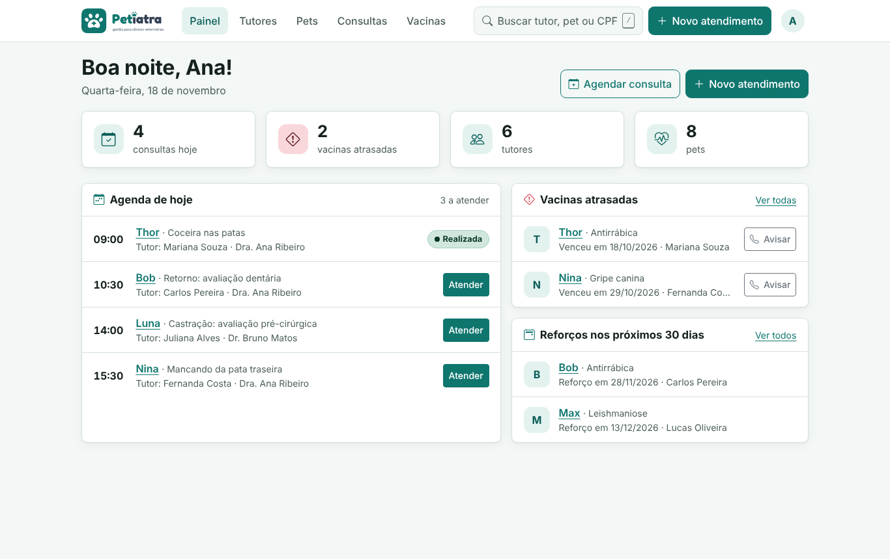
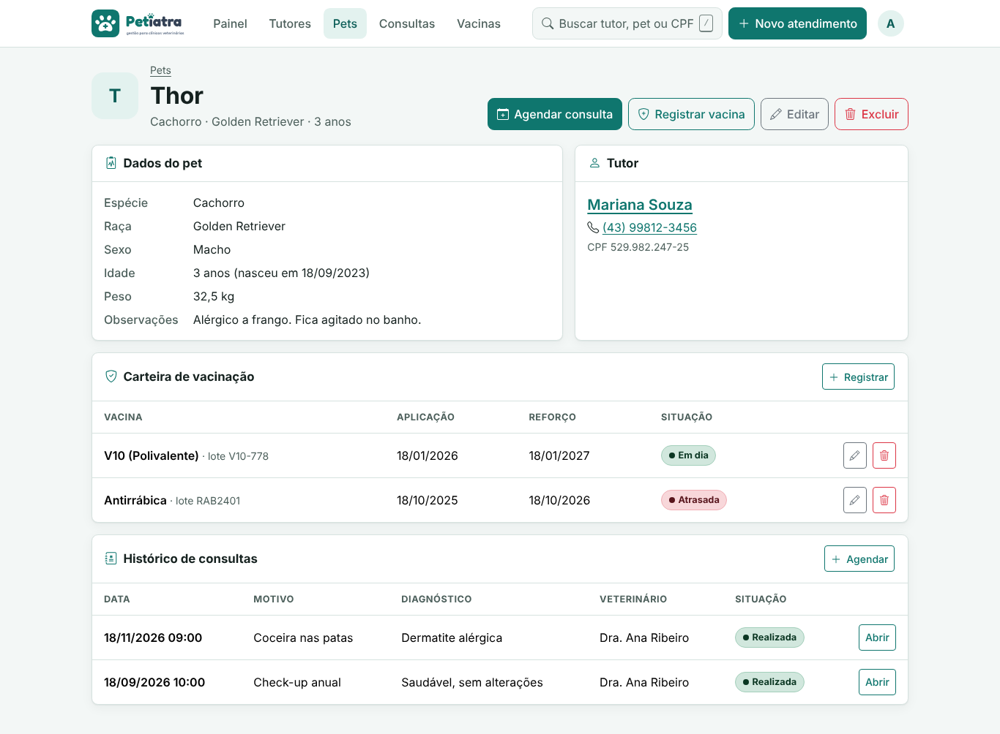
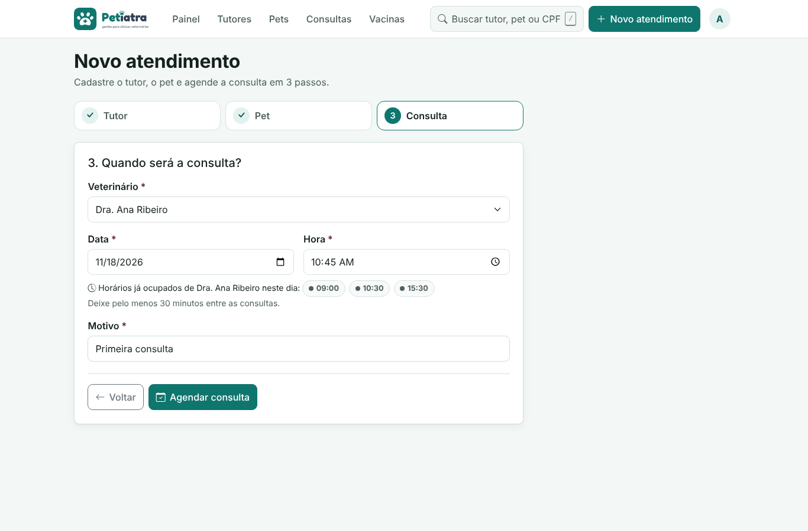
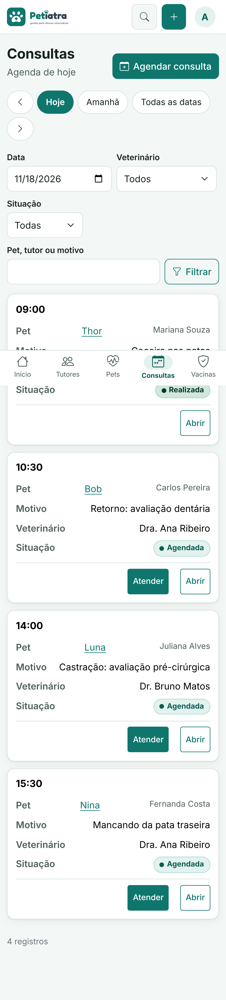

<p align="center">
  
</p>

# Petiatra: sistema web de gestão para clínicas veterinárias

Projeto das disciplinas **Projeto de Desenvolvimento de Software I e II** da UniFil.

**Autor:** Enzo Vasconcelos de Morais

> **Petiatra** = *pet* + *iatra*, do grego *iatrós* (médico), a mesma origem de "pediatra". Ou seja, "médico dos pets".

## Sobre o sistema

O Petiatra ajuda clínicas veterinárias de pequeno porte a:

- cadastrar **tutores** e **pets**;
- agendar e registrar **consultas** sem conflito de horário;
- manter a **carteira de vacinação** de cada pet;
- ver no painel inicial as consultas do dia e as **vacinas atrasadas**.

## Tecnologias

| Camada | Tecnologia |
|---|---|
| Linguagem | C# / .NET 10 (LTS) |
| Arquitetura | ASP.NET Core MVC (Controllers + Razor Views), SOLID, Clean Code |
| Dados | Entity Framework Core 10 + SQLite (trocável por SQL Server Express) |
| Interface | Bootstrap 5.3 responsivo (mobile-first) |
| Testes | xUnit |
| Modelagem | PlantUML |

## Situação

| Etapa | Situação | Onde está |
|---|---|---|
| Parte I: documentação | Concluída | [`docs/entrega/`](docs/entrega/) (PDF) e [`docs/diagramas/`](docs/diagramas/) |
| Parte II: implementação | Concluída | [`src/`](src/) e [`tests/`](tests/) |

## Como executar

Pré-requisito: [.NET SDK 10](https://dotnet.microsoft.com/download/dotnet/10.0).

```bash
git clone https://github.com/enzovasconcelosz/petiatra.git
cd petiatra
dotnet run --project src/Petiatra.Web
```

Abra o endereço mostrado no terminal (por padrão, `http://localhost:5062`). Na primeira execução, o banco SQLite `petiatra.db` é criado pelas migrations e recebe dados de exemplo com datas relativas ao dia de hoje.

Acesso de demonstração:

- **E-mail:** `ana@petiatra.com`
- **Senha:** `petiatra123`

Também é possível criar uma conta nova em "Cadastrar veterinário".

### Trocar para SQL Server Express

O banco é escolhido no `src/Petiatra.Web/appsettings.json`, sem mudar o código (RNF02):

```json
"Banco": { "Provedor": "SqlServer", "DadosDeExemplo": true },
"ConnectionStrings": { "SqlServer": "Server=.\\SQLEXPRESS;Database=Petiatra;Trusted_Connection=True;TrustServerCertificate=True" }
```

Com SQLite, o banco é criado pelas migrations; com SQL Server, as tabelas são criadas a partir do mesmo modelo do Entity Framework.

### Horário de funcionamento

O expediente da regra RN02 e o intervalo da regra RN01 também ficam no `appsettings.json`, na seção `Clinica` (padrão: 08:00 às 18:00, com 30 minutos entre consultas).

## Testes automatizados

```bash
dotnet test
```

São 69 testes xUnit das entidades e dos serviços. Eles rodam sobre um banco SQLite em memória, com um relógio fixo, e cobrem as regras RN01 a RN07, o login com hash de senha e a transação do "Novo atendimento".

## Telas

| Painel | Ficha do pet |
|---|---|
|  |  |

| Novo atendimento (passo 3) | Consultas no celular |
|---|---|
|  |  |

## Onde cada requisito está no código

| Requisito | Onde |
|---|---|
| UC01 Autenticar-se (RF01, RF02) | `ContaController`, `AuthService` (hash PBKDF2 do `PasswordHasher`) |
| UC02 Manter tutores (RF03, RF04) | `TutoresController`, `TutorService`, `TutorRepositorio` |
| UC03 Manter pets (RF05, RF06) | `PetsController`, `PetService`, `PetRepositorio` |
| UC04 Manter consultas (RF07 a RF09) | `ConsultasController`, `ConsultaService`, `Services/Regras` |
| UC05 Manter vacinas (RF10, RF11) | `VacinasController`, `VacinaService`, `VacinaRepositorio` |
| RF12 Painel inicial | `PainelController`, `PainelService` |
| RF13 Novo atendimento | `AtendimentoController`, `AtendimentoService` (uma transação) |
| RF14 Busca rápida (`/` ou `Ctrl+K`) | `BuscaController`, `BuscaService`, `wwwroot/js/site.js` |
| RN01 30 minutos entre consultas | `RegraConflitoDeHorario` e `Consulta.ConflitaCom` |
| RN02 Horário de funcionamento | `RegraHorarioDeFuncionamento` |
| RN03 CPF, e-mail e CRMV únicos | `TutorService`, `AuthService` e índices únicos no banco |
| RN04 Tutor com pets não é excluído | `TutorService.ExcluirAsync` e chave estrangeira `Restrict` |
| RN05 Excluir pet exclui o histórico | `PetConfiguracao` (exclusão em cascata) |
| RN06 Datas da vacina | `VacinaService` |
| RN07 Vacina atrasada | `Vacina.ObterSituacao` e `VacinaRepositorio` |

## Estrutura

```
src/Petiatra.Web/
├── Controllers/     recebem as requisições (C do MVC)
├── Views/           telas Razor (V do MVC)
├── ViewModels/      dados e validações de cada tela
├── Models/          entidades e enumerações (M do MVC: domínio)
├── Services/        regras de negócio e regras de agendamento (IRegraAgendamento)
├── Repositories/    acesso aos dados com Entity Framework Core
├── Data/            AppDbContext, mapeamento das tabelas, migrations e dados de exemplo
├── Infraestrutura/  injeção de dependência, formatos pt-BR e apoio às telas
└── wwwroot/         CSS, JavaScript, Bootstrap, ícones e favicon
tests/Petiatra.Tests/  testes xUnit
docs/
├── entrega/     PDF da documentação (Parte I)
├── diagramas/   diagramas UML e DER: fontes PlantUML (.puml) e imagens (.png)
├── telas/       capturas de tela do sistema
└── marca/       logo, ícone e favicons
```

Para gerar novamente as imagens de um diagrama a partir do arquivo `.puml`, use o [PlantUML](https://plantuml.com):

```bash
java -jar plantuml.jar -tpng docs/diagramas/*.puml
```
